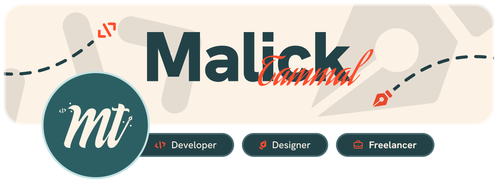

# `> About`
### I'am Abdel malek Tammal
#### I'm a freelance developer and designer who loves crafting clean, thoughtful interfaces and reliable software. I'm deep into Linux, system workflows, and working with AI agents, MCPs, and agentic tooling to build faster and smarter. Always open to interesting freelance projects and collaborations.
`Djelfa, Algeria` - `6 followers` - `29 repo`

 

# `> Projects`

<table>
  <tr>
    <td width="65%" valign="middle">
      <h3><a href="https://github.com/Malick-Tammal/chroma.nvim">Chroma.nvim</a></h3>
      
Lightweight, fast, and customizable Lua theming engine for Neovim
with 99+ built-in base46-compatible colorschemes. 🎨

      

        <code>Lua</code> · <code>Neovim</code>
      

    </td>
    <td width="35%" align="right" valign="middle">
      
    </td>
  </tr>
</table>

<table>
  <tr>
    <td width="35%" align="left" valign="middle">
      
    </td>
    <td width="65%" align="left" valign="middle">
      <h3><a href="https://github.com/Malick-Tammal/inscom.nvim">inscom.nvim</a></h3>
      
Inserts styled comment headers into your code. It detects the current filetype and uses the appropriate comment prefix/suffix.

      

        <code>Lua</code> · <code>Neovim</code>
      

    </td>
  </tr>
</table>

<table>
  <tr>
    <td width="65%" valign="middle">
      <h3><a href=https://github.com/Malick-Tammal/monokai-neovim">Monokai Neovim</a></h3>
      
This is my personal Neovim config ( clean and productive )
made for web development mainly and software development secondary

      

        <code>Lua</code> · <code>Neovim</code>
      

    </td>
    <td width="35%" align="right" valign="middle">
      
    </td>
  </tr>
</table>

 

# `> Tech stack`

### `- Frontend`

### `- Backend`

### `- Coding languages`

`Note: qt with quickshell`

### `- Tools`

### `- Desktop development`

### `- OS experience`

### `- Other`

 

---

   

  
  &nbsp;
  
  &nbsp;
  
  &nbsp;
  

   

━━━━━━━━━━━━━━━━━━━━ ✦ ━━━━━━━━━━━━━━━━━━━━

   

  
  

